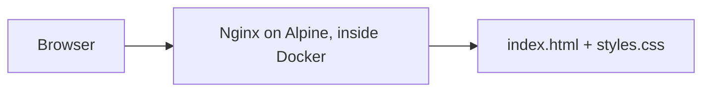

# Protist

Tiny Docker Container

## What's going on here

Protist is a very small web page that runs inside a Docker container. It's named after single-celled organisms, because it's about as simple as a website can get. It's a good starting point for learning how Docker packages and serves a site.

- One HTML page with a heading and a sentence
- One CSS file for the colors and centering
- A Dockerfile that puts both files into an Nginx web server
- Nginx is a fast, lightweight web server, and the `alpine` version keeps the container small

## What's inside

```text
protist/
├── Dockerfile
├── index.html
└── styles.css
```

## Why these technologies

- **HTML and CSS** are all a simple page needs
- **Docker** packages the page and server together
- **Nginx** is a fast, light web server
- **Alpine** keeps the image small

Here's how the pieces connect.



## Running it

You'll need Docker. Then do these steps from the project folder.

- Build the image with `docker build -t protist:latest .`
- Start a container with `docker run -d -p 8080:80 --name protist-app protist:latest`
- Open http://localhost:8080
- You should see the "Protist" heading on a light blue page

## Rebuilding after a change

Edited a file? You have to rebuild, because the files get copied into the image.

- Remove the old container with `docker rm -f protist-app`
- Build again with `docker build -t protist:latest .`
- Start it again with `docker run -d -p 8080:80 --name protist-app protist:latest`

## Good to know

- The container listens on port 80, and `-p 8080:80` makes it show up on port 8080 on your computer
- The `?v=1.1` on the stylesheet link in `index.html` helps browsers pick up CSS changes
- Bump that number if your browser keeps showing the old styles
